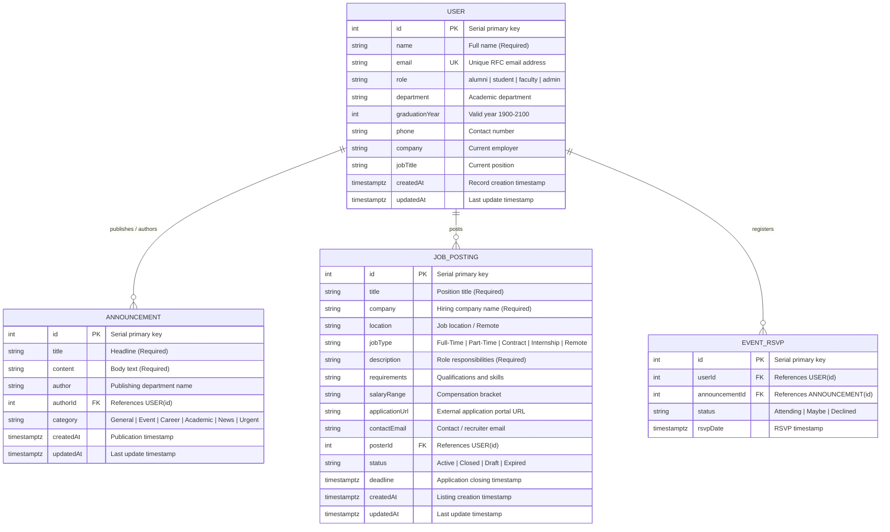

# 🏛️ Data Design & Architecture Documentation (DDD)

> **Platform:** Alumni Tracking System  
> **Status:** Active (PostgreSQL 15 Relational Persistence & In-Memory Fallback)  
> **Version:** 1.2.0  
> **Author:** Alumni Engineering Team  

---

## 📑 Table of Contents
1. [Executive Summary](#1-executive-summary)
2. [Data Layer Architecture & Philosophy](#2-data-layer-architecture--philosophy)
3. [Entity Specifications & Attributes](#3-entity-specifications--attributes)
   - [3.1 User Entity](#31-user-entity)
   - [3.2 Announcement Entity](#32-announcement-entity)
   - [3.3 Job Posting Entity](#33-job-posting-entity)
4. [Entity Relationship Diagram (ERD)](#4-entity-relationship-diagram-erd)
5. [In-Memory Store vs. Target Relational Schema](#5-in-memory-store-vs-target-relational-schema)
6. [Validation & Business Rules](#6-validation--business-rules)
   - [6.1 User Domain Constraints](#61-user-domain-constraints)
   - [6.2 Announcement Domain Constraints](#62-announcement-domain-constraints)
   - [6.3 Job Posting Domain Constraints](#63-job-posting-domain-constraints)
7. [Data Lifecycle & State Transitions](#7-data-lifecycle--state-transitions)
8. [Target PostgreSQL DDL Specification](#8-target-postgresql-ddl-specification)
9. [Migration Strategy & Zero-Downtime Roadmap](#9-migration-strategy--zero-downtime-roadmap)

---

## 1. Executive Summary

The **Alumni Tracking System** employs a decoupled, multi-tier data architecture following strict **Model-View-Controller (MVC)** principles.

- **Current State:** Active models ([`src/models/userModel.js`](../src/models/userModel.js) and [`src/models/announcementModel.js`](../src/models/announcementModel.js)) encapsulate in-memory array collections with defensive cloning, deterministic ID generators, query filtering, and schema validation. This allows instantaneous boot times, zero external database setup friction for development/testing, and complete container portability.
- **Target State:** The system is pre-configured with a containerized PostgreSQL 15 database (`alumni_db`), ready for seamless transition to durable relational persistence via Knex.js query builder or native connection pools without altering controller or view contracts.

---

## 2. Data Layer Architecture & Philosophy

```text
┌────────────────────────────────────────────────────────┐
│               HTTP Request (Web / REST API)            │
└───────────────────────────┬────────────────────────────┘
                            │
                            ▼
┌────────────────────────────────────────────────────────┐
│           Controllers (Input Parsing & Orchestration)  │
│      - apiUserController / userController              │
│      - apiAnnouncementController / announcementController│
└───────────────────────────┬────────────────────────────┘
                            │ Invokes Model methods
                            ▼
┌────────────────────────────────────────────────────────┐
│           Model Layer (Data Abstraction Layer)         │
│   - Defensive Immutability (Shallow Copy on Read/Write)│
│   - Input Validation & Domain Rule Enforcement         │
│   - Query Filtering, Substring Search, Pagination      │
└─────────────┬────────────────────────────┬─────────────┘
              │                            │
   (Phase 1: Current Runtime)   (Phase 2: Target Relational)
              ▼                            ▼
┌───────────────────────────┐┌───────────────────────────┐
│ In-Memory Array Store     ││ PostgreSQL 15 Relational  │
│ - Node.js Process Heap    ││ - ACID Transactions       │
│ - Seed Data Bootstrapping ││ - Foreign Key Integrity   │
│ - Ephemeral Lifecycle     ││ - Durable Named Volumes   │
└───────────────────────────┘└───────────────────────────┘
```

### 2.1 The In-Memory Lifecycle & "The Forgetting Test"
Because data is held in-process during Phase 1:
- State mutations survive normal HTTP lifecycles and controller dispatches.
- State is intentionally **forgotten** when containers are stopped (`docker compose down`) and restarted (`docker compose up -d`), resetting cleanly to canonical seed datasets.
- This design provides reproducible, side-effect-free automated testing across CI/CD pipelines.

---

## 3. Entity Specifications & Attributes

### 3.1 User Entity

The `User` entity models graduates, enrolled students, faculty members, and institutional staff.

| Field Name | In-Memory JS Type | PostgreSQL Type | Nullable | Default | Constraints & Rules | Description |
| :--- | :--- | :--- | :--- | :--- | :--- | :--- |
| `id` | `Number` (Integer) | `SERIAL` (INT PK) | **No** | Auto-inc | Primary Key, positive integer ($\ge 1$) | Unique identifier |
| `name` | `String` | `VARCHAR(255)` | **No** | — | Min 1 character, trimmed | Full name of the individual |
| `email` | `String` | `VARCHAR(255)` | **No** | — | Unique, RFC 5322 regex format, lowercased | Institutional / personal email |
| `role` | `String` | `VARCHAR(50)` | **No** | `'alumni'` | Whitelist: `'alumni'`, `'student'`, `'faculty'`, `'admin'` | Authorization role |
| `department` | `String` \| `null` | `VARCHAR(255)` | Yes | `null` | Trimmed string | Academic degree / faculty program |
| `graduationYear`| `Number` \| `null` | `INTEGER` | Yes | `null` | Range: $1900 \le \text{year} \le 2100$ | Year of graduation / completion |
| `phone` | `String` \| `null` | `VARCHAR(50)` | Yes | `null` | E.164 or common dial formats | Primary telephone number |
| `company` | `String` \| `null` | `VARCHAR(255)` | Yes | `null` | Trimmed string | Current employer or startup |
| `jobTitle` | `String` \| `null` | `VARCHAR(255)` | Yes | `null` | Trimmed string | Professional or academic title |
| `createdAt` | `String` (ISO 8601) | `TIMESTAMPTZ` | **No** | `NOW()` | System timestamp | Record creation timestamp |
| `updatedAt` | `String` (ISO 8601) | `TIMESTAMPTZ` | **No** | `NOW()` | System timestamp | Last modification timestamp |

---

### 3.2 Announcement Entity

The `Announcement` entity represents institutional broadcasts, career opportunities, event alerts, and news bulletins.

| Field Name | In-Memory JS Type | PostgreSQL Type | Nullable | Default | Constraints & Rules | Description |
| :--- | :--- | :--- | :--- | :--- | :--- | :--- |
| `id` | `Number` (Integer) | `SERIAL` (INT PK) | **No** | Auto-inc | Primary Key, positive integer ($\ge 1$) | Unique announcement ID |
| `title` | `String` | `VARCHAR(255)` | **No** | — | Required, non-empty, trimmed | Headline or subject |
| `content` | `String` | `TEXT` | **No** | — | Required, non-empty text | Body content / description |
| `author` | `String` | `VARCHAR(255)` | **No** | `'Alumni Relations Office'` | Non-empty string | Department or publisher |
| `authorId` *(Relational)* | `Number` \| `null` | `INTEGER` | Yes | `null` | `FK` referencing `users(id)` ON DELETE SET NULL | Author user reference |
| `category` | `String` | `VARCHAR(50)` | **No** | `'General'` | Whitelist: `'General'`, `'Event'`, `'Career'`, `'Academic'`, `'News'`, `'Urgent'` | Classification category |
| `createdAt` | `String` (ISO 8601) | `TIMESTAMPTZ` | **No** | `NOW()` | System timestamp | Creation timestamp |
| `updatedAt` | `String` (ISO 8601) | `TIMESTAMPTZ` | **No** | `NOW()` | System timestamp | Last update timestamp |

### 3.3 Job Posting Entity

The `JobPosting` entity represents career opportunities, internships, and professional openings shared by alumni, corporate partners, or university career coordinators.

| Field Name | In-Memory JS Type | PostgreSQL Type | Nullable | Default | Constraints & Rules | Description |
| :--- | :--- | :--- | :--- | :--- | :--- | :--- |
| `id` | `Number` (Integer) | `SERIAL` (INT PK) | **No** | Auto-inc | Primary Key, positive integer ($\ge 1$) | Unique job posting ID |
| `title` | `String` | `VARCHAR(255)` | **No** | — | Required, non-empty, trimmed | Job title or position designation |
| `company` | `String` | `VARCHAR(255)` | **No** | — | Required, non-empty, trimmed | Organization or enterprise offering the position |
| `location` | `String` | `VARCHAR(255)` | **No** | `'Remote'` | Non-empty string | Physical location or remote designation |
| `jobType` | `String` | `VARCHAR(50)` | **No** | `'Full-Time'` | Whitelist: `'Full-Time'`, `'Part-Time'`, `'Contract'`, `'Internship'`, `'Remote'` | Employment type classification |
| `description` | `String` | `TEXT` | **No** | — | Required, non-empty text | Detailed role responsibilities & scope |
| `requirements` | `String` \| `null` | `TEXT` | Yes | `null` | Free text / bullet points | Qualifications, skills, prerequisites |
| `salaryRange` | `String` \| `null` | `VARCHAR(100)` | Yes | `null` | Free text (e.g. `"$90k - $120k"`) | Compensation package or estimated range |
| `applicationUrl`| `String` \| `null` | `VARCHAR(500)` | Yes | `null` | Valid `http://` or `https://` URL | External application or career portal link |
| `contactEmail` | `String` \| `null` | `VARCHAR(255)` | Yes | `null` | RFC 5322 regex format, lowercased | Inquiries or resume submission email |
| `posterId` | `Number` \| `null` | `INTEGER` | Yes | `null` | `FK` referencing `users(id)` ON DELETE SET NULL | Alumni or employer user who posted the listing |
| `status` | `String` | `VARCHAR(50)` | **No** | `'Active'` | Whitelist: `'Active'`, `'Closed'`, `'Draft'`, `'Expired'` | Current lifecycle listing status |
| `deadline` | `String` (ISO 8601) \| `null`| `TIMESTAMPTZ` | Yes | `null` | Valid ISO 8601 timestamp | Application deadline cutoff timestamp |
| `createdAt` | `String` (ISO 8601) | `TIMESTAMPTZ` | **No** | `NOW()` | System timestamp | Initial posting timestamp |
| `updatedAt` | `String` (ISO 8601) | `TIMESTAMPTZ` | **No** | `NOW()` | System timestamp | Last record modification timestamp |

---

## 4. Entity Relationship Diagram (ERD)



---

## 5. In-Memory Store vs. Target Relational Schema

| Dimension | Active In-Memory Layer | Target PostgreSQL 15 Relational Layer |
| :--- | :--- | :--- |
| **Storage Backend** | Node.js V8 heap (`Array<Object>`) | Disk-backed ACID B-Tree tables in PostgreSQL container |
| **Primary Keys** | Runtime `Math.max(...ids) + 1` counter | Native SQL `SERIAL` sequences (`nextval()`) |
| **Integrity Checks** | Application-level JS code in Model classes | Database-level `UNIQUE`, `CHECK`, and `FOREIGN KEY` constraints |
| **Concurrency** | Single-threaded JavaScript event loop | Multi-process MVCC (Multi-Version Concurrency Control) with row locking |
| **Indexing** | Array scans (`Array.prototype.find`, `filter`) | B-Tree indexes on `email`, `role`, `category`, and composite search indexes |
| **Persistence** | Volatile (Resets on container restart) | Durable across container stops via `postgres_data` Docker volume |
| **Filter & Pagination** | Slice & sort algorithms in Model layer | SQL `ORDER BY`, `WHERE`, `LIMIT`, and `OFFSET` queries |

---

## 6. Validation & Business Rules

### 6.1 User Domain Constraints
1. **Email Integrity:**
   - Evaluated against regex `/^[^\s@]+@[^\s@]+\.[^\s@]+$/`.
   - Automatically normalized to lowercase and trimmed before uniqueness verification.
   - Rejection code: `HTTP 400 Bad Request` (or `409 Conflict` via API).
2. **Role Authorization Whitelist:**
   - Must strictly match one of: `['alumni', 'student', 'faculty', 'admin']`.
   - Defaults to `'alumni'` when omitted in creation payloads.
3. **Graduation Year Range:**
   - Must be an integer between `1900` and `2100`.
4. **Defensive Immutability:**
   - All read accessors (`findAll`, `findById`, `findByEmail`) return shallow copies:
     ```javascript
     return { ...user };
     ```
   - Prevents external controllers from corrupting in-memory reference pointers.

### 6.2 Announcement Domain Constraints
1. **Mandatory Content:**
   - `title` and `content` must be non-empty strings.
2. **Category Enforcement:**
   - Must match case-insensitively one of: `['General', 'Event', 'Career', 'Academic', 'News', 'Urgent']`.
   - Normalized to canonical PascalCase capitalization upon insertion.
3. **Default Author Attribution:**
   - If not provided, author defaults to `'Alumni Relations Office'`.

### 6.3 Job Posting Domain Constraints
1. **Mandatory Core Fields:**
   - `title`, `company`, and `description` are strictly required non-empty strings.
2. **Employment Type Whitelist:**
   - Must match case-insensitively one of: `['Full-Time', 'Part-Time', 'Contract', 'Internship', 'Remote']`.
   - Defaults to `'Full-Time'` when omitted.
3. **Publication Status Lifecycle:**
   - Must match one of: `['Active', 'Closed', 'Draft', 'Expired']`.
   - Defaults to `'Active'`.
   - Postings with an expired `deadline` timestamp automatically transition or filter to `'Expired'`.
4. **Application Link & Contact Validation:**
   - `applicationUrl` (when supplied) must match valid web URL protocols (`http://` or `https://`).
   - `contactEmail` (when supplied) must satisfy RFC 5322 email regex and normalize to lowercase.
   - For an active posting, at least one point of contact (`applicationUrl` or `contactEmail`) is recommended.
5. **Referential Integrity & User Linking:**
   - `posterId` references `users(id)`. If the posting author's account is removed, the foreign key cascades via `ON DELETE SET NULL` to preserve historical job archives.

---

## 7. Data Lifecycle & State Transitions

```text
 ┌─────────────┐
 │ Client POST │
 └──────┬──────┘
        │
        ▼
 ┌─────────────┐      Invalid
 │ Validate()  ├──────────────────▶ Emit HTTP 400 Bad Request
 └──────┬──────┘
        │ Valid
        ▼
 ┌─────────────┐
 │ Active /    │ ◀─── Read via GET (filter, search, pagination)
 │ Stored State│ ───▶ Mutate via PUT / PATCH (re-validates constraints)
 └──────┬──────┘
        │
        ▼ DELETE
 ┌─────────────┐
 │ Splice/Drop │ ───▶ Emit HTTP 200/204 Deleted Confirmation
 └─────────────┘
```

---

## 8. Target PostgreSQL DDL Specification

The following SQL schema provides the production migration specification for PostgreSQL 15:

```sql
-- =============================================================================
-- Migration: 001_create_alumni_tracking_schema.sql
-- =============================================================================

-- Enable UUID extension if needed in future iterations
CREATE EXTENSION IF NOT EXISTS "uuid-ossp";

-- 1. Users Table
CREATE TABLE IF NOT EXISTS users (
    id SERIAL PRIMARY KEY,
    name VARCHAR(255) NOT NULL,
    email VARCHAR(255) NOT NULL UNIQUE,
    role VARCHAR(50) NOT NULL DEFAULT 'alumni' 
        CHECK (role IN ('alumni', 'student', 'faculty', 'admin')),
    department VARCHAR(255),
    graduation_year INTEGER 
        CHECK (graduation_year BETWEEN 1900 AND 2100),
    phone VARCHAR(50),
    company VARCHAR(255),
    job_title VARCHAR(255),
    created_at TIMESTAMPTZ NOT NULL DEFAULT CURRENT_TIMESTAMP,
    updated_at TIMESTAMPTZ NOT NULL DEFAULT CURRENT_TIMESTAMP
);

-- Indexes for frequent queries
CREATE INDEX IF NOT EXISTS idx_users_email ON users(email);
CREATE INDEX IF NOT EXISTS idx_users_role ON users(role);
CREATE INDEX IF NOT EXISTS idx_users_department ON users(department);

-- 2. Announcements Table
CREATE TABLE IF NOT EXISTS announcements (
    id SERIAL PRIMARY KEY,
    title VARCHAR(255) NOT NULL,
    content TEXT NOT NULL,
    author VARCHAR(255) NOT NULL DEFAULT 'Alumni Relations Office',
    author_id INTEGER REFERENCES users(id) ON DELETE SET NULL,
    category VARCHAR(50) NOT NULL DEFAULT 'General'
        CHECK (category IN ('General', 'Event', 'Career', 'Academic', 'News', 'Urgent')),
    created_at TIMESTAMPTZ NOT NULL DEFAULT CURRENT_TIMESTAMP,
    updated_at TIMESTAMPTZ NOT NULL DEFAULT CURRENT_TIMESTAMP
);

-- Indexes for announcements
CREATE INDEX IF NOT EXISTS idx_announcements_category ON announcements(category);
CREATE INDEX IF NOT EXISTS idx_announcements_created_at ON announcements(created_at DESC);

-- 3. Job Postings Table
CREATE TABLE IF NOT EXISTS job_postings (
    id SERIAL PRIMARY KEY,
    title VARCHAR(255) NOT NULL,
    company VARCHAR(255) NOT NULL,
    location VARCHAR(255) NOT NULL DEFAULT 'Remote',
    job_type VARCHAR(50) NOT NULL DEFAULT 'Full-Time'
        CHECK (job_type IN ('Full-Time', 'Part-Time', 'Contract', 'Internship', 'Remote')),
    description TEXT NOT NULL,
    requirements TEXT,
    salary_range VARCHAR(100),
    application_url VARCHAR(500),
    contact_email VARCHAR(255),
    poster_id INTEGER REFERENCES users(id) ON DELETE SET NULL,
    status VARCHAR(50) NOT NULL DEFAULT 'Active'
        CHECK (status IN ('Active', 'Closed', 'Draft', 'Expired')),
    deadline TIMESTAMPTZ,
    created_at TIMESTAMPTZ NOT NULL DEFAULT CURRENT_TIMESTAMP,
    updated_at TIMESTAMPTZ NOT NULL DEFAULT CURRENT_TIMESTAMP
);

-- Indexes for job postings
CREATE INDEX IF NOT EXISTS idx_job_postings_poster_id ON job_postings(poster_id);
CREATE INDEX IF NOT EXISTS idx_job_postings_status ON job_postings(status);
CREATE INDEX IF NOT EXISTS idx_job_postings_job_type ON job_postings(job_type);
CREATE INDEX IF NOT EXISTS idx_job_postings_company ON job_postings(company);
CREATE INDEX IF NOT EXISTS idx_job_postings_created_at ON job_postings(created_at DESC);

-- Automatic timestamp trigger function
CREATE OR REPLACE FUNCTION update_timestamp_column()
RETURNS TRIGGER AS $$
BEGIN
    NEW.updated_at = CURRENT_TIMESTAMP;
    RETURN NEW;
END;
$$ LANGUAGE plpgsql;

CREATE TRIGGER set_timestamp_users
BEFORE UPDATE ON users
FOR EACH ROW
EXECUTE FUNCTION update_timestamp_column();

CREATE TRIGGER set_timestamp_announcements
BEFORE UPDATE ON announcements
FOR EACH ROW
EXECUTE FUNCTION update_timestamp_column();

CREATE TRIGGER set_timestamp_job_postings
BEFORE UPDATE ON job_postings
FOR EACH ROW
EXECUTE FUNCTION update_timestamp_column();
```

---

## 9. Migration Strategy & Zero-Downtime Roadmap

To migrate from the in-memory array implementation to PostgreSQL without breaking existing APIs or views:

1. **Repository / Adapter Pattern:**
   Introduce a Data Access Object (DAO) interface matching existing method signatures:
   - `findAll(filter)`
   - `findById(id)`
   - `create(data)`
   - `update(id, data)`
   - `delete(id)`
2. **Environment Toggle (`DATA_SOURCE`):**
   ```env
   DATA_SOURCE=postgres # Options: 'memory' | 'postgres'
   ```
   Allows fallback to in-memory during local lightweight unit testing and seamless activation of PostgreSQL in staging/production environments.
3. **Zero Controller Changes:**
   Controllers (`apiUserController`, `apiAnnouncementController`, etc.) continue consuming `UserModel` and `AnnouncementModel` contracts without needing to know whether queries are satisfied via memory slices or PostgreSQL connection pools.
