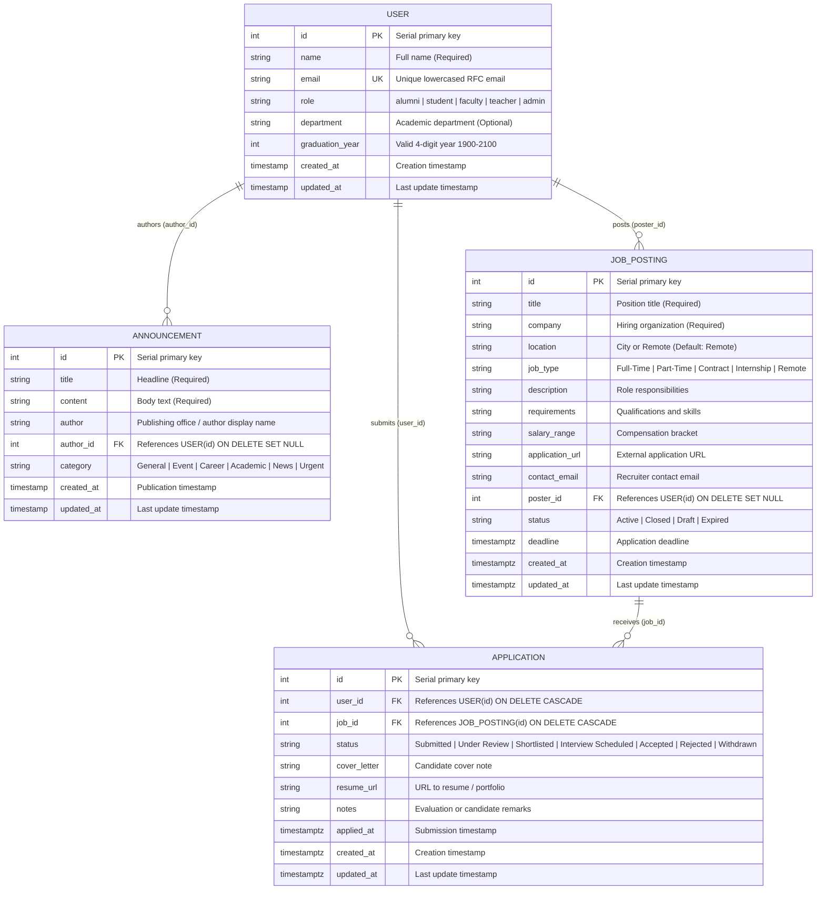

# 🏛️ Alumly — Domain-Driven Design & Data Architecture Documentation (`ddd.md`)

> **Platform:** Alumly — Modern Alumni & Career Network  
> **Persistence Layer:** PostgreSQL 15 Relational Database (`src/config/db.js`)  
> **Version:** 2.0.0  
> **Status:** Active Canonical Domain Specification  
> **Related Specs:** [`brand.md`](../brand.md) · [`design.md`](../design.md) · [`README.md`](../README.md) · Root copy: [`ddd.md`](../ddd.md)

---

## 📑 Table of Contents
1. [Executive Summary & Ubiquitous Language](#1-executive-summary--ubiquitous-language)
2. [Bounded Contexts & Domain Architecture](#2-bounded-contexts--domain-architecture)
3. [Users Domain & User Roles (Core Aggregate)](#3-users-domain--user-roles-core-aggregate)
   - [3.1 User Aggregate & Entity Specification](#31-user-aggregate--entity-specification)
   - [3.2 Role Value Object & Role Definitions](#32-role-value-object--role-definitions)
   - [3.3 Role-Permission Matrix](#33-role-permission-matrix)
   - [3.4 Access Boundaries & Enforcement Status](#34-access-boundaries--enforcement-status)
   - [3.5 User Relationships & Cross-Aggregate Interactions](#35-user-relationships--cross-aggregate-interactions)
4. [Supporting Aggregates & Entity Specifications](#4-supporting-aggregates--entity-specifications)
   - [4.1 Announcement Aggregate](#41-announcement-aggregate)
   - [4.2 Job Posting Aggregate](#42-job-posting-aggregate)
   - [4.3 Application Aggregate (Many-to-Many Join)](#43-application-aggregate-many-to-many-join)
5. [Entity Relationship Diagram (ERD)](#5-entity-relationship-diagram-erd)
6. [Domain Invariants & Validation Rules](#6-domain-invariants--validation-rules)
7. [Data Lifecycle & State Transitions](#7-data-lifecycle--state-transitions)
8. [PostgreSQL 15 DDL & Migration Reference](#8-postgresql-15-ddl--migration-reference)
9. [Observability, Telemetry & Fault Tolerance Architecture](#9-observability-telemetry--fault-tolerance-architecture)

---

## 1. Executive Summary & Ubiquitous Language

**Alumly** is a containerized web platform and RESTful API built on **Node.js**, **Express**, and **PostgreSQL 15**, structured around **Model-View-Controller (MVC)** separation and **Domain-Driven Design (DDD)** principles.

All active domain models (`UserModel`, `AnnouncementModel`, `JobPostingModel`, `ApplicationModel`) execute parameterized SQL queries directly against PostgreSQL 15 via the connection pool in `src/config/db.js`, enforcing ACID transactions, referential integrity, and domain invariants.

### 📖 Ubiquitous Language Glossary

| Domain Term | Definition in Alumly |
| :--- | :--- |
| **Member / User** | Any registered individual within the Alumly ecosystem—spanning graduates, current students, academic faculty, teachers, and platform administrators. |
| **Role** | A constrained Value Object (`alumni`, `student`, `faculty`, `teacher`, `admin`) classifying a member's institutional relationship and intended platform responsibilities. |
| **Alumni Directory** | The searchable, filterable registry of all Alumly members (`/users` and `/api/users`). |
| **Job Posting** | A career opportunity, internship, or contract opening published to the Job Board (`/jobs` and `/api/jobs`) and optionally attributed to a posting `User` (`posterId`). |
| **Application** | A candidate's formal submission linking a `User` (applicant) to a `JobPosting`, tracking recruitment workflow state from `Submitted` through `Accepted` / `Rejected` / `Withdrawn`. |
| **Announcement** | An institutional broadcast, reunion alert, career notice, or academic bulletin (`/announcements` and `/api/announcements`) optionally linked to an authoring `User` (`authorId`). |

---

## 2. Bounded Contexts & Domain Architecture

Alumly is organized into four cohesive **Bounded Contexts** backed by a shared relational persistence layer:

```text
┌─────────────────────────────────────────────────────────────────────────┐
│                         ALUMLY PLATFORM DOMAINS                         │
├──────────────────────────────┬──────────────────────────────────────────┤
│ Bounded Context              │ Core Aggregate / Responsibility          │
├──────────────────────────────┼──────────────────────────────────────────┤
│ 1. Identity & Directory      │ User Aggregate (Profiles, Roles, Search) │
│ 2. Career Opportunities      │ JobPosting Aggregate (Listings, Filters) │
│ 3. Recruitment & Applications│ Application Aggregate (M:N Join, Status) │
│ 4. Institutional Broadcasts  │ Announcement Aggregate (News, Events)    │
└──────────────────────────────┴──────────────────────────────────────────┘
```

```text
┌────────────────────────────────────────────────────────┐
│               HTTP Request (Web / REST API)            │
└───────────────────────────┬────────────────────────────┘
                            │
                            ▼
┌────────────────────────────────────────────────────────┐
│   Controllers (Input Parsing, Content Negotiation)     │
│   - userController / apiUserController                 │
│   - jobController / apiJobController                   │
│   - applicationController / apiApplicationController   │
│   - announcementController / apiAnnouncementController │
└───────────────────────────┬────────────────────────────┘
                            │ Delegates to Domain Models
                            ▼
┌────────────────────────────────────────────────────────┐
│        Domain Model Layer (src/models/)                │
│   - Domain Validation & Invariant Enforcement          │
│   - Relational Querying & Eager Association Loading    │
│   - Parameterized SQL Execution (src/config/db.js)     │
└───────────────────────────┬────────────────────────────┘
                            │
                            ▼
┌────────────────────────────────────────────────────────┐
│        PostgreSQL 15 Relational Persistence            │
│   - ACID Transactions & Foreign Key Constraints        │
│   - Composite Uniqueness & B-Tree Indexing             │
│   - Durable Storage via Docker Named Volumes           │
└────────────────────────────────────────────────────────┘
```

---

## 3. Users Domain & User Roles (Core Aggregate)

The **Identity & Directory** bounded context centers on the `User` aggregate root (`src/models/userModel.js`). Every other core aggregate in Alumly (`JobPosting`, `Application`, `Announcement`) references `User` as an author, poster, or candidate applicant.

### 3.1 User Aggregate & Entity Specification

- **Aggregate Root:** `User`
- **Unique Identity:** `id` (`SERIAL PRIMARY KEY`, positive integer $\ge 1$) and natural business key `email` (case-insensitive unique constraint).
- **Source of Truth:** `src/migrations/001_create_initial_tables.sql`, `src/models/userModel.js`, `src/controllers/userController.js`, `src/controllers/apiUserController.js`.

#### Persisted Core Attributes (`users` table)

| Attribute (JS) | PostgreSQL Column | SQL Type | Nullable | Default | Constraints & Domain Invariants | Description |
| :--- | :--- | :--- | :---: | :--- | :--- | :--- |
| `id` | `id` | `SERIAL` (INT PK) | **No** | Auto-inc | Primary Key, positive integer ($\ge 1$) | Surrogate aggregate identifier |
| `name` | `name` | `VARCHAR(255)` | **No** | — | Required, non-empty string, trimmed | Full name of the member |
| `email` | `email` | `VARCHAR(255)` | **No** | — | Unique (`UNIQUE`), RFC 5322 regex (`/^[^\s@]+@[^\s@]+\.[^\s@]+$/`), trimmed & lowercased | Primary institutional or personal email |
| `role` | `role` | `VARCHAR(50)` | **No** | `'alumni'` | Whitelist: `'alumni'`, `'student'`, `'faculty'`, `'teacher'`, `'admin'` (normalized lowercase) | Institutional role classification |
| `department` | `department` | `VARCHAR(255)` | Yes | `NULL` | Optional trimmed string | Academic department or faculty program |
| `graduationYear` | `graduation_year` | `INTEGER` | Yes | `NULL` | 4-digit integer in range `1900–2100` | Graduation or expected completion year |
| `createdAt` | `created_at` | `TIMESTAMP` | **No** | `NOW()` | System-managed immutable timestamp | Record creation timestamp |
| `updatedAt` | `updated_at` | `TIMESTAMP` | **No** | `NOW()` | Updated on every `PUT` / `PATCH` mutation | Last modification timestamp |

#### Extended Profile Attributes (Accepted in Controllers & Web UI)

> [!NOTE]
> The web forms (`src/views/htmlViews.js`) and controllers (`userController.js`, `apiUserController.js`) also accept optional career/contact attributes—**`phone`**, **`company`**, and **`jobTitle`**—in user payloads. In the current PostgreSQL migration (`001_create_initial_tables.sql`) and `UserModel` SQL statements, only the 8 core columns above are actively persisted; adding `phone`, `company`, and `job_title` columns to `users` is a straightforward additive migration for future releases.

#### User Aggregate Invariants
1. **Mandatory Identity Fields:** `name` and `email` must be non-empty strings on creation (`POST`) and full replacement (`PUT`). Invalid payloads return `HTTP 400 Bad Request`.
2. **Case-Insensitive Email Uniqueness:** Emails are trimmed and lowercased prior to duplicate lookup (`UserModel.findByEmail`) and backed by the PostgreSQL `UNIQUE` constraint (`23505`). Duplicate emails return `HTTP 409 Conflict`.
3. **Strict Role Whitelist:** `role` is validated against `UserModel.ROLES`. Any unrecognized role value is rejected with `HTTP 400 Bad Request`. If omitted during creation, `role` defaults to `'alumni'`.
4. **Graduation Year Bounds:** When supplied, `graduationYear` must parse to an integer between `1900` and `2100` inclusive.

---

### 3.2 Role Value Object & Role Definitions

The `Role` Value Object is canonically defined in `UserModel.ROLES` (`src/models/userModel.js`) and exposed in all Alumni Directory creation/edit forms (`src/views/htmlViews.js`):

```text
UserModel.ROLES = ['alumni', 'student', 'faculty', 'teacher', 'admin']
```

| Role Value | Display Label | Purpose in the Alumly Ecosystem | Primary Responsibilities |
| :--- | :--- | :--- | :--- |
| **`alumni`** *(default)* | **Alumni** | Graduates of the institution forming the core professional and mentorship network. | Maintain graduate profile in the Alumni Directory, share career opportunities on the Job Board (`posterId`), apply to open roles via `Application`, and read institutional announcements. |
| **`student`** | **Student** | Currently enrolled undergraduate or graduate students preparing for internships and early-career transitions. | Browse the Alumni Directory for networking, discover internships and entry-level roles on the Job Board, submit and track job applications, and stay informed via Announcements. |
| **`faculty`** | **Faculty** | University professors, department heads, and academic researchers bridging academia and industry. | Maintain academic profile, post research internships or academic openings (e.g., AI Research Internships), author departmental/academic announcements, and mentor students/alumni. |
| **`teacher`** | **Teacher** | Academic instructors and lecturers participating in student guidance and campus communication. | Maintain instructor profile, browse alumni career trajectories, share academic or career announcements, and connect students with relevant opportunities. |
| **`admin`** | **Admin** | Institutional administrators and Alumni Relations Office staff governing platform operations. | Full administrative oversight across all modules: manage user directory records and role assignments, moderate/curate job postings, oversee application pipelines, and publish/manage official institutional announcements. |

---

### 3.3 Role-Permission Matrix

The matrix below documents the canonical Alumly domain authorization model across all four core modules.

**Legend:** `C` = Create · `R` = Read · `U` = Update · `D` = Delete · `(Own)` = Scoped to records owned/created by the user

| Role | Alumni Directory (`/users`) | Job Board (`/jobs`) | Applications (`/applications`) | Announcements (`/announcements`) |
| :--- | :--- | :--- | :--- | :--- |
| **`alumni`** | `R` (Directory) · `U` (Own profile) | `R` (All) · `C / U / D` (Own postings) | `C` (Apply) · `R / U` (Own applications; review applicants on own jobs) | `R` (All bulletins) |
| **`student`** | `R` (Directory) · `U` (Own profile) | `R` (All active listings) | `C` (Apply) · `R / U` (Own applications, e.g., withdraw) | `R` (All bulletins) |
| **`faculty`** | `R` (Directory) · `U` (Own profile) | `R` (All) · `C / U / D` (Own academic/research postings) | `R / U` (Review applicants for own postings) | `R` (All) · `C / U / D` (Own academic/event bulletins) |
| **`teacher`** | `R` (Directory) · `U` (Own profile) | `R` (All) · `C / U / D` (Own postings) | `R / U` (Review applicants for own postings) | `R` (All) · `C / U / D` (Own bulletins) |
| **`admin`** | `C / R / U / D` (Full user & role management) | `C / R / U / D` (All job postings & moderation) | `C / R / U / D` (All applications & pipeline statuses) | `C / R / U / D` (All institutional broadcasts) |

---

### 3.4 Access Boundaries & Enforcement Status

- **Job Board Boundaries:**
  - `admin`, `alumni`, `faculty`, and `teacher` roles are intended to publish and manage opportunities (`posterId`).
  - `student` accounts are consumers of the Job Board—focused on discovering internships and full-time openings rather than publishing employer listings.
- **Announcements Boundaries:**
  - `admin`, `faculty`, and `teacher` roles represent official institutional voices authorized to publish, edit, and retire campus bulletins (`authorId`).
  - `alumni` and `student` roles consume announcements in read-only mode.
- **User Administration Boundaries:**
  - Only `admin` should delete arbitrary member accounts or reassign roles (`alumni` → `admin`, etc.). Non-admin members are scoped to viewing the directory and editing their own profiles.
- **Current Codebase Enforcement Note:**
  - **Enforced Today:** Domain-level role validation (`UserModel.ROLES` whitelist, case normalization, and `'alumni'` default) is actively enforced on every `POST`, `PUT`, and `PATCH` request in `UserModel`, and role filtering is supported via `GET /api/users?role=<role>`.
  - **Planned Security Layer:** Route-level authentication (JWT/session middleware) and RBAC guard middleware are not yet mounted on Express routes so all web and API CRUD workflows remain directly testable in local/containerized environments. Introducing auth + RBAC middleware will enforce the matrix above at the HTTP boundary without modifying domain models.

---

### 3.5 User Relationships & Cross-Aggregate Interactions

Defined canonically in `src/models/index.js` (`RELATIONS.User`) and `src/models/userModel.js`:

| Relationship | Cardinality | Foreign Key & Cascade Policy | Model Accessor | REST API Sub-Route |
| :--- | :---: | :--- | :--- | :--- |
| **`User` → `Announcement`** | **1 : N** (`hasMany`) | `announcements.author_id` → `users.id` (`ON DELETE SET NULL`) | `UserModel.getAnnouncements(userId)` | `GET /api/users/:id/announcements` |
| **`User` → `JobPosting`** | **1 : N** (`hasMany`) | `job_postings.poster_id` → `users.id` (`ON DELETE SET NULL`) | `UserModel.getJobPostings(userId)` | `GET /api/users/:id/jobs` |
| **`User` → `Application`** | **1 : N** (`hasMany`) | `applications.user_id` → `users.id` (`ON DELETE CASCADE`) | `UserModel.getApplications(userId)` | `GET /api/users/:id/applications` |
| **`User` ↔ `JobPosting`** | **M : N** (`through Application`) | `applications(user_id, job_id)` (`UNIQUE`, `ON DELETE CASCADE`) | `UserModel.getAppliedJobs(userId)` | `GET /api/users/:id/applied-jobs` |
| **`User` (Eager Graph)** | **Aggregate Snapshot** | Parallel fetch of all 4 associations | `UserModel.findByIdWithRelations(id)` | `GET /api/users/:id/relations` |

#### Referential Integrity Semantics on User Deletion
- **Historical Preservation (`ON DELETE SET NULL`):** Deleting a `User` preserves published `announcements` and `job_postings` for institutional history by nullifying `author_id` and `poster_id`.
- **Candidate Privacy (`ON DELETE CASCADE`):** Deleting a `User` automatically purges all personal `applications` submitted by that user.

---

## 4. Supporting Aggregates & Entity Specifications

### 4.1 Announcement Aggregate

The `Announcement` aggregate (`src/models/announcementModel.js`) models institutional broadcasts, event invitations, career fairs, and academic news.

| Field Name (JS) | PostgreSQL Type | Nullable | Default | Constraints & Rules | Description |
| :--- | :--- | :---: | :--- | :--- | :--- |
| `id` | `SERIAL` (INT PK) | **No** | Auto-inc | Primary Key ($\ge 1$) | Unique announcement ID |
| `title` | `VARCHAR(255)` | **No** | — | Required, non-empty, trimmed | Headline or subject |
| `content` | `TEXT` | **No** | — | Required, non-empty text | Body content |
| `author` | `VARCHAR(255)` | **No** | `'Alumni Relations Office'` | Non-empty display label | Publishing office or name |
| `authorId` | `INTEGER` | Yes | `NULL` | `FK` → `users(id)` `ON DELETE SET NULL` | Authoring `User` reference |
| `category` | `VARCHAR(50)` | **No** | `'General'` | Whitelist: `'General'`, `'Event'`, `'Career'`, `'Academic'`, `'News'`, `'Urgent'` | Bulletin category |
| `createdAt` | `TIMESTAMP` | **No** | `NOW()` | System timestamp | Publication timestamp |
| `updatedAt` | `TIMESTAMP` | **No** | `NOW()` | System timestamp | Last update timestamp |

### 4.2 Job Posting Aggregate

The `JobPosting` aggregate (`src/models/jobPostingModel.js`) represents career opportunities, internships, and contract roles published on the Alumly Job Board.

| Field Name (JS) | PostgreSQL Type | Nullable | Default | Constraints & Rules | Description |
| :--- | :--- | :---: | :--- | :--- | :--- |
| `id` | `SERIAL` (INT PK) | **No** | Auto-inc | Primary Key ($\ge 1$) | Unique job posting ID |
| `title` | `VARCHAR(255)` | **No** | — | Required, non-empty, trimmed | Position title |
| `company` | `VARCHAR(255)` | **No** | — | Required, non-empty, trimmed | Hiring organization |
| `location` | `VARCHAR(255)` | **No** | `'Remote'` | Trimmed string | City, hybrid, or remote |
| `jobType` | `VARCHAR(50)` | **No** | `'Full-Time'` | Whitelist: `'Full-Time'`, `'Part-Time'`, `'Contract'`, `'Internship'`, `'Remote'` | Employment classification |
| `description` | `TEXT` | **No** | — | Role responsibilities & overview | Detailed job description |
| `requirements` | `TEXT` | Yes | `NULL` | Skills & qualifications | Candidate prerequisites |
| `salaryRange` | `VARCHAR(100)` | Yes | `NULL` | Free text (e.g., `"$80,000 - $110,000"`) | Compensation range |
| `applicationUrl` | `VARCHAR(500)` | Yes | `NULL` | Valid `http://` or `https://` URL | External application portal |
| `contactEmail` | `VARCHAR(255)` | Yes | `NULL` | RFC 5322 email, lowercased | Recruiter contact email |
| `posterId` | `INTEGER` | Yes | `NULL` | `FK` → `users(id)` `ON DELETE SET NULL` | Posting `User` reference |
| `status` | `VARCHAR(50)` | **No** | `'Active'` | Whitelist: `'Active'`, `'Closed'`, `'Draft'`, `'Expired'` | Lifecycle listing status |
| `deadline` | `TIMESTAMPTZ` | Yes | `NULL` | Valid ISO 8601 timestamp | Application cutoff date |
| `createdAt` | `TIMESTAMPTZ` | **No** | `CURRENT_TIMESTAMP` | System timestamp | Creation timestamp |
| `updatedAt` | `TIMESTAMPTZ` | **No** | `CURRENT_TIMESTAMP` | Auto-updated via trigger | Last modification timestamp |

### 4.3 Application Aggregate (Many-to-Many Join)

The `Application` aggregate (`src/models/applicationModel.js`) models the Many-to-Many relationship between `User` (applicant) and `JobPosting` (career listing), tracking candidate progression through the recruitment pipeline.

| Field Name (JS) | PostgreSQL Type | Nullable | Default | Constraints & Rules | Description |
| :--- | :--- | :---: | :--- | :--- | :--- |
| `id` | `SERIAL` (INT PK) | **No** | Auto-inc | Primary Key ($\ge 1$) | Unique application ID |
| `userId` | `INTEGER` | **No** | — | `FK` → `users(id)` `ON DELETE CASCADE` | Candidate `User` ID |
| `jobId` | `INTEGER` | **No** | — | `FK` → `job_postings(id)` `ON DELETE CASCADE` | Target `JobPosting` ID |
| `status` | `VARCHAR(50)` | **No** | `'Submitted'` | Whitelist: `'Submitted'`, `'Under Review'`, `'Shortlisted'`, `'Interview Scheduled'`, `'Accepted'`, `'Rejected'`, `'Withdrawn'` | Recruitment workflow stage |
| `coverLetter` | `TEXT` | Yes | `NULL` | Optional candidate pitch | Cover letter / note |
| `resumeUrl` | `VARCHAR(500)` | Yes | `NULL` | Valid `http://` or `https://` URL | Digital CV / portfolio link |
| `notes` | `TEXT` | Yes | `NULL` | Optional reviewer/candidate remarks | Evaluation notes |
| `appliedAt` | `TIMESTAMPTZ` | **No** | `CURRENT_TIMESTAMP` | System timestamp | Submission timestamp |
| `createdAt` | `TIMESTAMPTZ` | **No** | `CURRENT_TIMESTAMP` | System timestamp | Record creation timestamp |
| `updatedAt` | `TIMESTAMPTZ` | **No** | `CURRENT_TIMESTAMP` | Auto-updated via trigger | Last status update timestamp |

> [!IMPORTANT]
> **Duplicate Application Safeguard:** The composite constraint `CONSTRAINT uq_applications_user_job UNIQUE (user_id, job_id)` guarantees that a single `User` can hold at most one application per `JobPosting`. Duplicate attempts fail with `HTTP 409 Conflict`.

---

## 5. Entity Relationship Diagram (ERD)



---

## 6. Domain Invariants & Validation Rules

### 6.1 User Domain Invariants
1. **Email Integrity:** Validated against `/^[^\s@]+@[^\s@]+\.[^\s@]+$/`, normalized to trimmed lowercase, and checked for uniqueness before insert/update (`400 Bad Request` / `409 Conflict`).
2. **Role Value Object Validation:** Must match one of `['alumni', 'student', 'faculty', 'teacher', 'admin']` (case-insensitive input normalized to lowercase); defaults to `'alumni'` when omitted.
3. **Graduation Year Range:** Optional integer strictly bounded between `1900` and `2100`.
4. **Query & Search Support:** Supports filtering by `role`, substring matching on `department`, free-text search (`search` / `q`) across `name`, `email`, and `department`, plus `limit` / `page` pagination.

### 6.2 Announcement Domain Invariants
1. **Mandatory Content:** `title` and `content` must be non-empty trimmed strings.
2. **Category Whitelist:** Case-insensitive match against `['General', 'Event', 'Career', 'Academic', 'News', 'Urgent']`, defaulting to `'General'`.
3. **Author Attribution:** Defaults to `'Alumni Relations Office'` when omitted; optionally linked to `users(id)` via `author_id`.

### 6.3 Job Posting Domain Invariants
1. **Mandatory Fields:** `title` and `company` are required non-empty strings.
2. **Employment Type Whitelist:** `['Full-Time', 'Part-Time', 'Contract', 'Internship', 'Remote']`, defaulting to `'Full-Time'`.
3. **Status Lifecycle Whitelist:** `['Active', 'Closed', 'Draft', 'Expired']`, defaulting to `'Active'`.
4. **Contact & Link Validation:** `applicationUrl` (when provided) must use `http://` or `https://`; `contactEmail` (when provided) must satisfy email format validation.

### 6.4 Application Domain Invariants
1. **Composite Uniqueness:** `UNIQUE (user_id, job_id)` prevents duplicate applications by the same candidate for the same job (`409 Conflict`).
2. **Workflow Status Whitelist:** `['Submitted', 'Under Review', 'Shortlisted', 'Interview Scheduled', 'Accepted', 'Rejected', 'Withdrawn']`, defaulting to `'Submitted'`.
3. **Referential Cascades:** Deleting either the candidate `User` or target `JobPosting` cascades deletion to dependent `Application` rows.

---

## 7. Data Lifecycle & State Transitions

```text
 ┌─────────────┐
 │ Client POST │
 └──────┬──────┘
        │
        ▼
 ┌─────────────┐      Invalid / Duplicate
 │ Validate()  ├──────────────────────────▶ Emit HTTP 400 / 409
 └──────┬──────┘
        │ Valid
        ▼
 ┌─────────────┐
 │ Persisted   │ ◀─── Read via GET (filter, search, pagination, relations)
 │ PostgreSQL  │ ───▶ Mutate via PUT / PATCH (re-validates invariants)
 └──────┬──────┘
        │
        ▼ DELETE
 ┌─────────────┐
 │ Delete Row  │ ───▶ Cascade / Set Null FKs ───▶ Emit HTTP 200 Confirmation
 └─────────────┘
```

---

## 8. PostgreSQL 15 DDL & Migration Reference

Production tables are managed via sequential SQL migrations in `src/migrations/`:
- [`001_create_initial_tables.sql`](../src/migrations/001_create_initial_tables.sql) — `users`, `announcements`, and initial seed records (`admin`, `alumni`, `student`, `faculty`).
- [`002_create_job_postings_table.sql`](../src/migrations/002_create_job_postings_table.sql) — `job_postings`, `announcements.author_id` FK, B-Tree indexes, `update_timestamp_column()` trigger, and initial job seeds.
- [`003_create_applications_table.sql`](../src/migrations/003_create_applications_table.sql) — `applications` M:N join table, `uq_applications_user_job`, indexes, trigger, and sample applications.

```sql
-- Canonical Users Table Specification (aligned with UserModel.ROLES)
CREATE TABLE IF NOT EXISTS users (
    id SERIAL PRIMARY KEY,
    name VARCHAR(255) NOT NULL,
    email VARCHAR(255) UNIQUE NOT NULL,
    role VARCHAR(50) NOT NULL DEFAULT 'alumni'
        CHECK (role IN ('alumni', 'student', 'faculty', 'teacher', 'admin')),
    department VARCHAR(255),
    graduation_year INTEGER
        CHECK (graduation_year BETWEEN 1900 AND 2100),
    created_at TIMESTAMP DEFAULT NOW(),
    updated_at TIMESTAMP DEFAULT NOW()
);
```

---

## 9. Observability, Telemetry & Fault Tolerance Architecture

To ensure operational reliability across both Web and REST API layers, Alumly enforces a standardized Express middleware pipeline:

1. **Global Request Duration Logger (`src/middlewares/logger.js`):**
   - Intercepts every incoming request and logs completion in standard format: `[time] [method] [route] [res.type] [duration]`.
2. **Dual-Mode 404 Route Guardian (`src/middlewares/guardian404.js` & `src/views/404.html`):**
   - Mounted strictly after all valid routes.
   - Returns structured JSON `404` for `/api/*` or `Accept: application/json` requests, and renders the Alumly iOS glassmorphism `404.html` page for browser requests.
3. **5xx Global Error Guardian & Async Wrapping (`src/middlewares/guardian5xx.js` & `src/middlewares/asyncHandler.js`):**
   - Uses the 4-parameter Express error signature `(err, req, res, next)` placed at the very end of the middleware chain.
   - Logs full stack traces to `console.error`, appends structured forensic records to `logs/error.logs` (excluded from Git via `.gitignore`), and returns structured JSON `{ "status": "error", "message": "Internal Server Error" }` with HTTP `500`.
